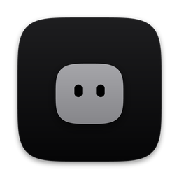
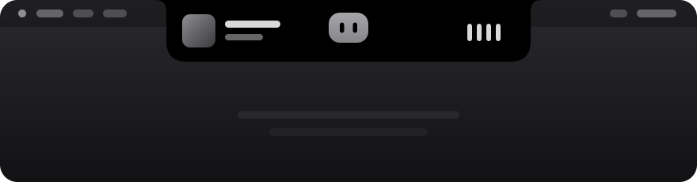

<p align="center">
  
</p>

<h1 align="center">Blob</h1>

<p align="center">
  <b>A soft, monochrome notch for your Mac.</b><br>
  Blob turns the dead space around the MacBook notch into a black shape that springs open on hover.<br>
  A small grey character inside shows how things are going, through motion alone.
</p>

<p align="center">
  
  
  
  
</p>

<p align="center">
  
</p>

<p align="center">
  <a href="#get-started">Get started</a> ·
  <a href="#what-it-does">Features</a> ·
  <a href="#meet-blob">The character</a> ·
  <a href="#iphone-blob-island">iPhone</a> ·
  <a href="#for-developers">Developers</a>
</p>

---

## Get started

```bash
git clone https://github.com/arjunchalapathy0/blob.git && cd blob
./scripts/bootstrap.sh      # installs xcodegen + cmake, vendors Now Playing, generates the project
open Blob.xcodeproj         # pick your team under Signing & Capabilities, then Run
```

After that, Blob updates itself: **Settings → Updates → Update**, or the ⬇ button in the notch when a new version is waiting.

> [!TIP]
> Building on someone else's Apple account? App IDs are unique per account, so run `./scripts/set-prefix.sh com.theirname` first, reopen the project and set their Team.

## What it does

| | |
|---|---|
| 🎵 **Now Playing** | Artwork, scrubber and controls. Live wings (art + equalizer) while music plays. |
| 🔊 **System HUD** | Volume and brightness keys show in the notch instead of the macOS overlay. |
| 📥 **Shelf** | Drag files onto the notch to park them. Drag them out, AirDrop, reveal. |
| 📋 **Clipboard** | Recent copies; click to copy again, pin favorites. Password-manager items are skipped. |
| 📅 **Calendar** | Today at a glance, a countdown before meetings, one-click Join for Zoom / Meet / Teams. |
| ⏱️ **Timers** | Quick presets, several at once, and a stopwatch. The countdown lives in the wings. |
| ✳️ **Claude Code** | Shows when Claude is working, done, or waiting on you, per session. |
| 💬 **Ask** | Ask Claude about what's on your screen. Blob captures the display (without itself) only when you hit Enter. Answers with your Claude subscription through Claude Code. |
| 🎙️ **Voice agent** | Hold **right ⌥**, say what you want, let go. Whisper transcribes on-device and Claude Code does it: runs commands, controls apps, opens things, looks at your screen. It asks before deleting, sending or buying. |
| 🪞 **Mirror** | Camera preview before calls, plus camera and microphone pickers. The camera runs only while the tab is open. |
| 🧰 **Tools** | Keep awake, color picker, screenshot to clipboard, dark mode, sleep display. |
| 📈 **Stats** | CPU, memory, network and battery with sparklines. Charger notices. |
| 🔒 **Privacy lock** | Optional Touch ID (or password) lock on Clipboard, Shelf and Ask. |

Every module can be switched off in Settings.

## Meet Blob

Blob is a grey rounded rectangle with two eyes. Only its motion changes.

| Mood | When | What it does |
|---|---|---|
| **idle** | nothing going on | slow breathing, blinks, glances around |
| **curious** | you hover | leans in, eyes follow the cursor |
| **happy** | music playing | hops on the beat |
| **busy** | Claude is working | wiggles while its eyes read left to right |
| **alarmed** | timer done, Claude needs you | jumps and shakes |
| **sleepy** | left alone for 10 minutes | squashes down, eyes shut, little z's |

Moods blend on a damped spring, so every change overshoots slightly and settles.

## iPhone: Blob Island

The same project builds a small iPhone app (iOS 17+). iOS doesn't let apps replace the Dynamic Island, so Blob uses Live Activities:

- **Timers** count down in the Dynamic Island and on the Lock Screen, with a notification at the end.
- **Today**: tap **Island** on an event to count down to it.
- **Ask**: pick or paste a screenshot or photo and ask Claude about it, through your Mac (Claude subscription) or with an Anthropic API key.
- **Claude**: live Claude Code status from your Mac, and tasks you send to it. Turn on Settings → Claude Code → **Show on iPhone** on the Mac, then enter the pairing code in the iPhone's Claude tab. Both need the same Wi-Fi.

<details>
<summary><b>Install on iPhone</b></summary>

**Quick update (from your Mac):** Blob Settings → Updates → **Update iPhone**, or `git pull && ./scripts/phone.sh`. Builds and installs over the cable or Wi-Fi and renews the 7-day limit.

**With Xcode:** open `Blob.xcodeproj`, choose the **BlobPhone** scheme and your iPhone, set your Team on both **BlobPhone** and **BlobIsland**, and press Run. On the iPhone, trust your profile under Settings → General → VPN & Device Management. A free Apple account works; apps installed that way expire after 7 days.

**Without Xcode (SideStore):** every push to `main` builds `Blob.ipa` on GitHub Actions and attaches it to the **phone-latest** release. Set up [SideStore](https://sidestore.io) once, then open the release on your iPhone, download `Blob.ipa` and share it to SideStore. It re-signs with your Apple ID and refreshes every 7 days.

</details>

## Permissions

Blob asks for each one only when you use the feature that needs it.

| Permission | Why | Asked from |
|---|---|---|
| Accessibility | Catch volume / brightness keys to replace the system HUD | Settings → System HUD |
| Calendar | Upcoming events | Calendar tab |
| Camera | Mirror | Mirror tab |
| Microphone | Voice agent (transcribed on this Mac) | First hold of right ⌥ |
| Screen Recording | Ask (one screenshot per question) | Ask tab |
| Automation | Dark-mode toggle; AppleScript fallback for Now Playing | First use |

---

## For developers

macOS 14+ · Swift / SwiftUI in an AppKit panel · XcodeGen · one package (WhisperKit). See [ARCHITECTURE.md](ARCHITECTURE.md) for the design.

```
Blob/
  App/        entry point, app delegate, notch panel + window controller, settings window, updater
  Core/       theme, springs, notch shape, geometry, prefs, view model, shared components
    Character/  moods and the procedural motion engine
  Views/      root, closed (wings + peek) and open (header + tabs) views
  Modules/    NowPlaying, SystemHUD, Shelf, Clipboard, Calendar, Timers, ClaudeCode,
              Ask, Agent, QuickTools, Stats, Camera, Lock
  Settings/   settings form
iOS/          BlobPhone (app) and BlobIsland (Live Activities widget)
Shared/       code shared by Mac and iPhone (bridge protocol, Live Activity model, face)
scripts/      bootstrap, update, phone, release, icons, adapter vendoring
```

After changing `project.yml`, run `xcodegen generate`. The `.xcodeproj` is generated and not committed.

<details>
<summary><b>How updating works</b></summary>

**Update** runs `scripts/update.sh`, which:
1. runs `git pull` in the source folder (the clone Blob was built from; changeable in Settings),
2. rebuilds a Release copy with Xcode, signed with the same team as the running app,
3. quits Blob, replaces `/Applications/Blob.app` and relaunches it.

Blob checks for new commits at launch and every 6 hours. Each build is signed with your own certificate, so macOS keeps your permissions. Run it by hand with `./scripts/update.sh build`.

</details>

<details>
<summary><b>Release (Developer ID + notarization)</b></summary>

```bash
xcrun notarytool store-credentials blob --apple-id you@example.com --team-id TEAMID
TEAM_ID=TEAMID NOTARY_PROFILE=blob ./scripts/release.sh   # produces dist/Blob.zip
```

Blob ships outside the App Store on purpose: the sandbox would block the Now Playing adapter, the media-key tap and the Claude Code hook.

</details>

<details>
<summary><b>How Now Playing works</b></summary>

macOS 15.4 stopped third-party apps from reading Now Playing through MediaRemote. Blob picks a source at launch:

1. **macOS 15.4+**: [`mediaremote-adapter`](https://github.com/ungive/mediaremote-adapter). The system `/usr/bin/perl` may still use MediaRemote, so Blob runs the adapter's script through it and reads a stream of JSON. `scripts/fetch-mediaremote-adapter.sh` builds it into `Vendor/`, and a build phase embeds and signs it.
2. **macOS 14 – 15.3**: MediaRemote directly.
3. **Fallback**: AppleScript for Music and Spotify.

Settings → Now Playing shows which source is active.

</details>

<details>
<summary><b>Claude Code integration</b></summary>

Settings → Claude Code → **Install** adds hooks to `~/.claude/settings.json` (after saving a backup as `settings.json.blob-backup`):

```json
"hooks": { "PreToolUse": [{ "matcher": "*", "hooks": [{ "type": "command", "command": "\"/Applications/Blob.app/Contents/MacOS/Blob\" --claude-hook", "timeout": 5 }] }], ... }
```

Each hook runs the Blob binary in a headless mode that writes one small JSON file per session to `~/.blob/claude/` and exits; the running app watches that folder. Covered events: `SessionStart`, `UserPromptSubmit`, `PreToolUse`, `PostToolUse`, `Notification`, `Stop`, `SessionEnd`. If you move Blob.app, Settings offers to update the hook path.

</details>

<details>
<summary><b>Tuning the feel</b></summary>

- Springs: `Blob/Core/Springs.swift`
- Notch sizes and corner radii: `NotchViewModel.openSize`, `bodySize`, `topRadius`, `bottomRadius`
- Wing widths per activity: `LiveActivity.wingWidth`
- Character motion: `Mood.pose(at:)` in `Blob/Core/Character/Mood.swift`
- Colors: `Blob/Core/Theme.swift` (black surface, white ink at a few opacities, one grey)
- Vihaan Helped with this project btw

</details>
